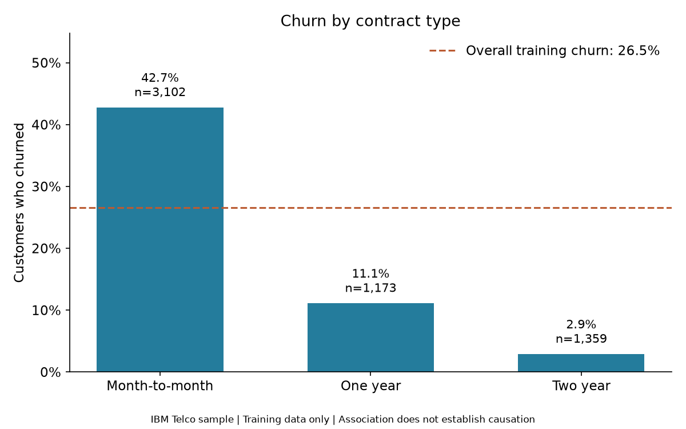
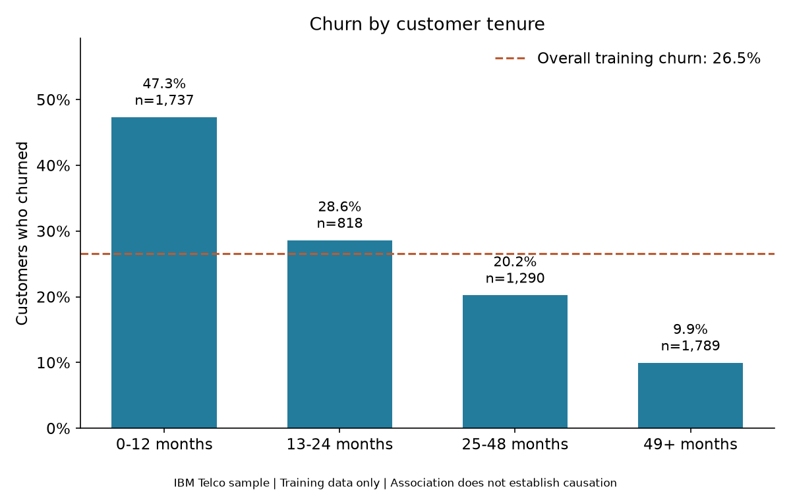
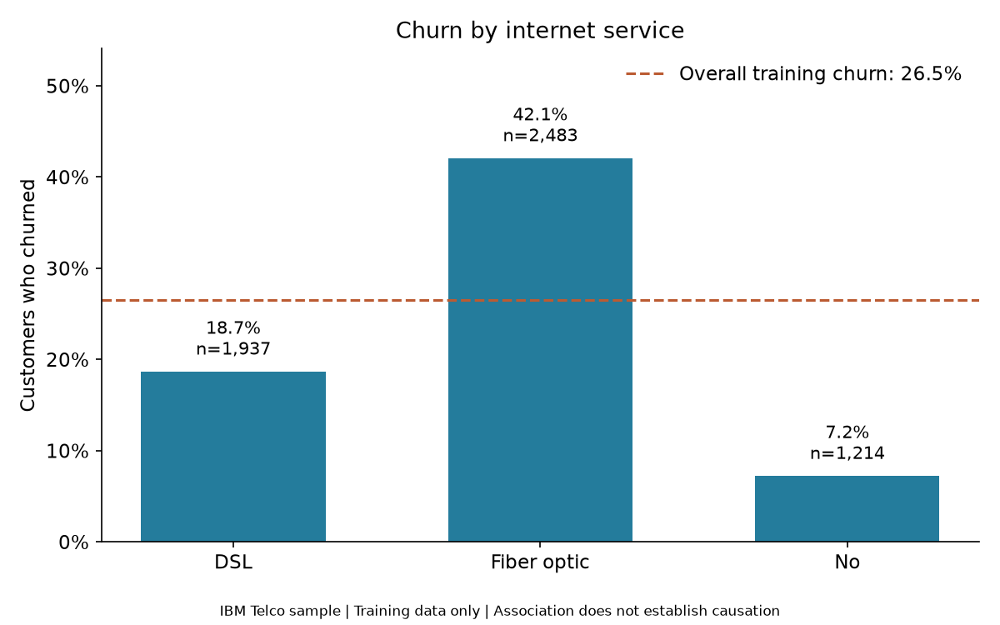
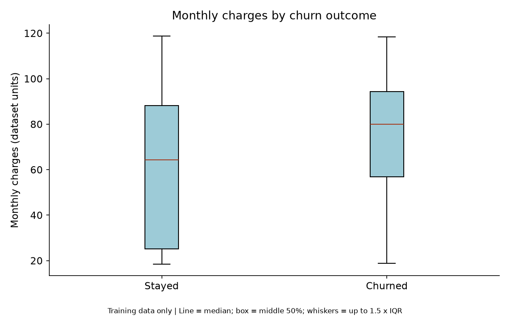

# Customer Churn Predictor Using a Decision Tree Classifier

## 1. Title and research question

**Can a decision-tree model use a telecom customer's service and billing details to predict whether they will leave?**

I built this academic machine-learning model in Python to predict whether a telecom customer will churn (`Yes`) or stay (`No`).

## 2. Key findings

I analyzed the training set only. Group differences show associations; they do not prove that a factor causes churn.









- Churn was **42.7%** for month-to-month customers, **11.1%** for one-year contracts, and **2.9%** for two-year contracts.
- Customers in their first 12 months had a **47.3%** churn rate; customers with 49 or more months had a **9.9%** rate.
- Churn was **42.1%** among fiber-optic customers, compared with **18.7%** for DSL and **7.2%** for customers without internet service. Customers who churned had a median monthly charge of **79.95**, compared with **64.40** among those who stayed (dataset units).

## 3. Model and results

I compared the decision tree with a simple baseline that predicts every customer will stay. Final results are from the **1,409 held-out test records**, which I did not use for training or model selection.

| Metric | Always-stayed baseline | Decision tree |
| --- | ---: | ---: |
| Accuracy | 73.5% | **79.3%** |
| Churn precision | 0.0% | **61.4%** |
| Churn recall | 0.0% | **59.9%** |
| Churn F1 score | 0.000 | **0.606** |

The tree correctly classified **894 customers who stayed** and **224 who churned**. It produced **141 false alarms** and missed **150 churners**. Precision is the share of churn alerts that were correct; recall is the share of actual churners detected. The baseline's accuracy is relatively high because most customers in the test set stayed, even though it found no churners.

I selected the final tree settings—maximum depth **5** and minimum leaf size **20**—from six combinations using five-fold cross-validated churn F1. Validation F1 was **0.578** and held-out test F1 was **0.606**. Their similarity suggests no large performance gap in these results, though it does not prove the model is free from overfitting.

## 4. Recommendation

In this sample, month-to-month customers had **42.7%** churn and customers in their first 12 months had **47.3%** churn. A retention team could consider prioritizing these groups for outreach and testing contract incentives. Fiber-optic customers churned at **42.1%**, compared with **18.7%** for DSL customers, so I recommend investigating possible reasons for that difference. These are associations; a small pilot should test any intervention before a wider rollout. I recommend treating the model as a screening aid and evaluating it with current, representative company data before any real use.

## 5. How it was built

I used IBM's Telco Customer Churn sample dataset: **7,043 customer records and 21 columns**. I divided the records into **5,634 training rows (80%)** and **1,409 test rows (20%)**, using a stratified split with random seed `42`.

I used six attributes as model inputs: `tenure`, `MonthlyCharges`, `Contract`, `InternetService`, `TechSupport`, and `PaymentMethod`. `Churn` is the target label (`Yes` or `No`); I excluded `customerID` from the inputs.

Using Python, pandas, and scikit-learn, I checked and prepared the data, explored patterns in the training set, converted categories to numeric indicators, and handled numeric missing values with medians learned from training data. I compared tree settings using five-fold validation on the training set, selected the tree by churn F1 score, then evaluated the saved model once on the reserved test set. The saved pipeline predicts churn from customer details entered in the interactive script.

I included the source CSV at `data/raw/Telco-Customer-Churn.csv`. If it is missing from the project copy, download it from IBM's [Telco Customer Churn sample dataset](https://github.com/IBM/telco-customer-churn-on-icp4d/blob/master/data/Telco-Customer-Churn.csv) and save it at that path.

## 6. Setup and how to run

I used Python 3.14 during development. In PowerShell, open this project folder and run:

```powershell
py -m venv .venv
.\.venv\Scripts\Activate.ps1
python -m pip install -r requirements.txt
```

Run the workflow scripts in order:

```powershell
python .\check_environment.py
python .\inspect_dataset.py
python .\prepare_data.py
python .\explore_data.py
python .\check_preprocessing.py
python .\train_model.py
python .\evaluate_model.py
```

To enter a customer's details and get a prediction:

```powershell
python .\predict_customer.py
```

To show predictions for five existing held-out test customers:

```powershell
python .\predict_customer.py --demo
```

The demo reads existing test records; it does not generate new data. The trained model and preprocessing pipeline are saved in `models/churn_pipeline.joblib`.

## 7. Limitations

The dataset represents a fictional telecom business and may not reflect current Philippine customers, local pricing, or local service patterns. The model also missed 150 of the 374 actual churners and incorrectly flagged 141 customers who stayed. The six input attributes were selected for a manageable classroom project; this project does not prove they are the best attributes. Predictions are uncertain and should not be treated as facts or used for automatic decisions.

## 8. AI-assistance disclosure

I used generative AI as a coding and learning assistant to plan the workflow, draft and debug Python code, interpret model metrics, and prepare explanatory text. I trained the churn predictor with scikit-learn's decision-tree classifier on the cited dataset; generative AI did not produce the churn predictions.
